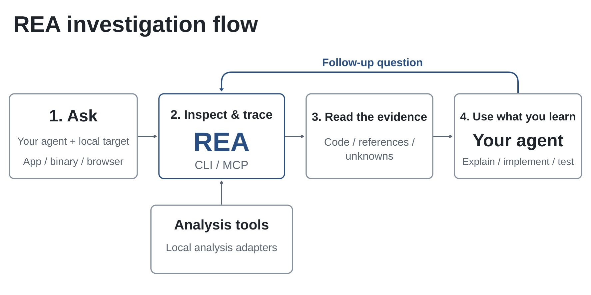

<div align="center">

# Khaos: Reverse Engineer the Web Surface

### One MCP for understanding how sites, APIs and applications work from the outside.

**Point it at a site or a recorded session. Get back the API it talks to, with the evidence.**

[](https://github.com/morluto/rea)
[](docs/mcp-contracts.md#generated-catalog)
[](LICENSE)

[How Khaos works](#how-khaos-works) · [What Khaos adds](#what-khaos-adds) · [What you can analyze](#what-you-can-analyze) · [Example investigations](#example-investigations) · [FAQ](#faq) · [Documentation](#documentation)

<br />


<br /><br />

</div>

---

Khaos is a fork of [REA](https://github.com/morluto/rea) focused on the web. Its goal is to answer one question for an agent: what does this site or app actually expose, and how do its parts talk to each other? It maps pages, forms and endpoints of a site you have no account for, turns a recorded browsing session into an API specification, and keeps everything REA already does for binaries, JavaScript and Electron apps, Android and .NET.

Your agent calls Khaos through MCP, and the same tools run from the terminal. Analysis runs locally. Every result carries the evidence behind it and lists what could not be determined, so the agent can tell a fact from an inference.

## How Khaos works

Your agent calls Khaos through MCP to inspect a target and trace the relevant code or traffic. Khaos returns findings with their evidence. The agent uses them to ask follow-up questions, explain the behavior, or write and test an implementation. CLI commands use the same workflows.



## What Khaos adds

Two tools cover the web surface that REA reached only through a live browser session.

**`crawl_web_site`: map a site from the outside.** It fetches HTTP(S) resources directly, without running JavaScript, and recovers pages, links, forms with field names and types, JSON-LD types and the shape of JSON responses. It infers endpoint candidates, each with an HTTP method and a path template (`{numeric}`, `{uuid}`, `{hex}`, `{iso-date}`), from three places: HTML forms, `fetch`/axios/`XMLHttpRequest` call sites in inline and linked scripts, and OpenAPI documents published at well-known paths. Crawls stay on the same origin by default, every budget (pages, depth, scripts, bytes, time) is bounded, and values you mark as sensitive are redacted from the report. See [docs/web-crawl.md](docs/web-crawl.md).

**`map_api`: turn a recorded session into an API.** From one HAR, mitmproxy or Fiddler SAZ capture, it groups requests by method, origin and inferred path template, and reports query parameter names, request and response body fields with their types, content types, observed statuses and GraphQL operation names. It then generates an OpenAPI 3.1 document and a TypeScript client. It never contacts the recorded URLs, and credential values are dropped by the capture decoder, so only names and shapes reach the output. See [docs/web-network-captures.md](docs/web-network-captures.md#one-shot-api-map-and-generated-artifacts).

Used together, the crawl gives the static surface and the capture gives what the app really calls at runtime. Candidates the crawl cannot confirm are reported as inferences, to be checked against a capture.

## What you can analyze

Everything REA analyzes is still here. Additional tools depend on the target:

| Target                 | What Khaos returns                                                                   | Requirements and guide                                                                                                                |
| ---------------------- | ------------------------------------------------------------------------------------ | ------------------------------------------------------------------------------------------------------------------------------------- |
| Websites (no session)  | Pages, forms, JSON shapes and endpoint candidates with path templates                | Network access to the target; [web crawl](docs/web-crawl.md)                                                                          |
| Saved network captures | API map, OpenAPI 3.1 document, TypeScript client, requests and payload shapes        | HAR or Fiddler Everywhere SAZ; mitmdump on Linux for native mitmproxy; [capture guide](docs/web-network-captures.md)                  |
| Websites (live)        | Page structure, scripts, network observations and requested screenshots              | A Chrome-family browser                                                                                                               |
| JavaScript / Electron  | Modules, imports, source maps, routes, IPC and native add-on relationships           | Node.js and npm                                                                                                                       |
| Native binaries        | Pseudocode, assembly, strings, symbols, calls and references                         | Hopper, Ghidra or IDA                                                                                                                 |
| Go binaries            | Embedded compiler version, modules, replacements and build settings                  | Built-in static ELF/PE/thin Mach-O inspection                                                                                         |
| WASM artifact          | Validation, sections, exact import/export WAT forms and decoded WAT                  | Caller-supplied WABT 1.0.42                                                                                                           |
| .NET assemblies        | Metadata, CIL instructions, declared native dependencies and build comparisons       | None (static only); [managed-code guide](docs/managed-code-analysis.md)                                                               |
| Android APKs           | Manifest declarations, classes, decompiled methods and references                    | Headless JADX and a full JDK; [Android guide](docs/android-analysis.md)                                                               |
| Android devices        | Devices, packages, processes, logs, dumps, screen captures, and APK/file transfers   | Caller-supplied adb; [ADB guide](docs/adb-device-analysis.md)                                                                         |
| Flutter apps           | Dart snapshot hash, per-ABI library digests and engine build provenance              | None (static APK parsing); [Flutter guide](docs/flutter-analysis.md)                                                                  |
| SQLite databases       | Tables, columns, indexes, views, triggers and selected ordinary-table rows           | Local database/WAL snapshot                                                                                                           |
| Firmware               | Regions, extraction results and native-analysis handoffs                             | Binwalk / Unblob on Linux; [firmware guide](docs/firmware-analysis.md)                                                                |
| Recorded packets       | Endpoints, DNS, TLS SNI, protocol distribution, HTTP requests and selected fields    | TShark; [pcap guide](docs/pcap-analysis.md)                                                                                           |
| Process behavior       | Terminal output, interactions, exit and filesystem observations, and run comparisons | Linux/macOS with a native PTY; [process capture](docs/process-capture.md)                                                             |

Static inspection reads the supplied files without running the application. The crawler sends real HTTP requests to the target; runtime capture runs or interacts with the selected target using your user permissions.

## Example investigations

These are the kinds of questions Khaos is built for. Replace the target with your own.

### Map the API behind a public site

```text
Crawl example.com, list the endpoints its forms and scripts call, and tell me
which ones are confirmed by an OpenAPI document and which are only inferred.
```

### Turn a recorded session into a client

```text
Map the API in session.har, generate the OpenAPI document and a TypeScript
client, and point out any endpoint that returned errors.
```

### Follow a feature from the page into the app

```text
Find where the export button in this Electron app sends its request, show the
IPC path from renderer to main process, and compare it with the calls in my capture.
```

## FAQ

<details>
<summary><strong>How is Khaos different from REA?</strong></summary>

Khaos adds `crawl_web_site` and `map_api`, so an agent can map a site with no account and turn a recorded session into an API specification. Everything else comes from REA.

</details>

<details>
<summary><strong>Does the crawler run JavaScript?</strong></summary>

No. It reads HTML and scripts as text and infers calls from literal call sites. URLs built at runtime, request bodies, auth headers and client-rendered routes are not recovered. Use a capture and `map_api`, or the live browser tools, when you need them.

</details>

<details>
<summary><strong>Does <code>map_api</code> leak credentials from my capture?</strong></summary>

Credential values are dropped by the capture decoder. The map, the OpenAPI document and the client contain names and shapes only, and the tool never calls the recorded URLs.

</details>

<details>
<summary><strong>Does Khaos upload my targets?</strong></summary>

Analysis runs locally. Your agent receives the tool results, and its model provider has its own data policy. The crawler is the only tool that contacts a remote host, and only the one you point it at.

</details>

<details>
<summary><strong>What may I analyze?</strong></summary>

Only targets you own or are authorized to test. Respect each site's terms and rate limits; the crawler can honor `robots.txt` with `respect_robots`. See [DISCLAIMER.md](DISCLAIMER.md).

</details>

## Documentation

- [Web crawl](docs/web-crawl.md): scope, budgets, endpoint inference and limits.
- [Network captures](docs/web-network-captures.md): capture inspection and the one-shot API map.
- [CLI and Evidence](docs/cli.md): commands, provider selection, snapshots, import/export and exit statuses.
- [MCP contracts](docs/mcp-contracts.md) and [agent prompts](docs/mcp-prompts.md): tool results, sessions and guided investigations.
- [Tool catalog](docs/mcp-contracts.md#generated-catalog): generated inventory of tools, providers and CLI commands.
- [Architecture map](docs/architecture.mermaid): project structure.

Report vulnerabilities through [SECURITY.md](SECURITY.md).

## Credits

Khaos is built on [REA (Reverse Engineer Anything)](https://github.com/morluto/rea) by morluto and its contributors, which provides the MCP server, the evidence model and all analysis outside the two tools above. Khaos adds `crawl_web_site` and `map_api` and is maintained by Roberto Quirino.

## License

[MIT](LICENSE). The original REA copyright notice is kept in the license file.

Third-party material retains its own licenses and copyright notices; see [Third-party notices](THIRD_PARTY_NOTICES.md).

**You must legally obtain and be authorized to use commercial tools**, including IDA Pro / Hex-Rays decompilers, Hopper, and JEB, under their applicable licenses. Khaos grants no tool license, key, or activation entitlement.
